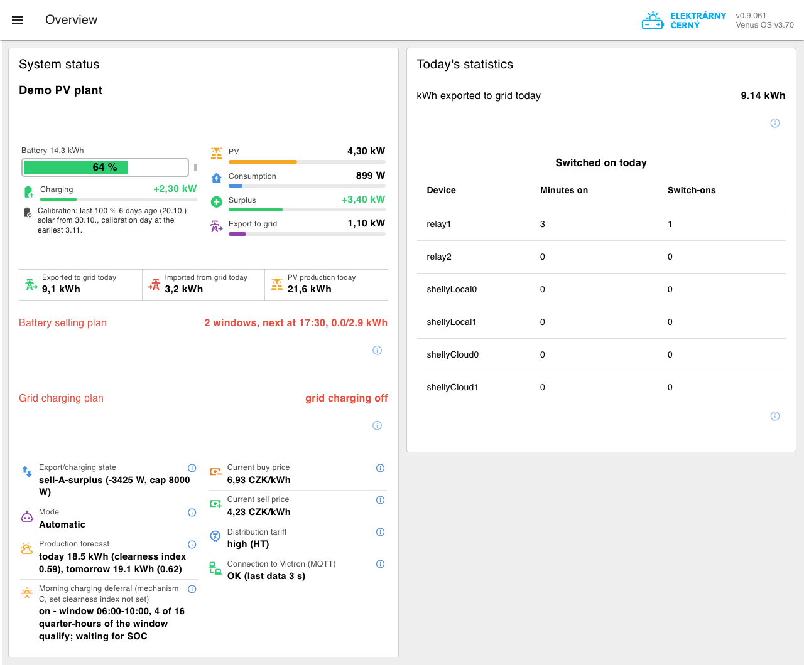
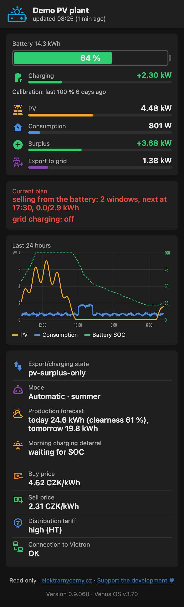
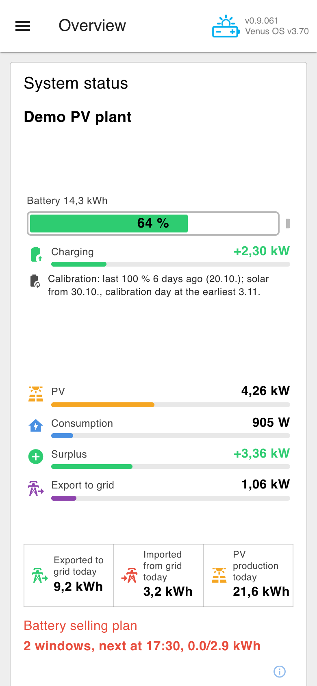
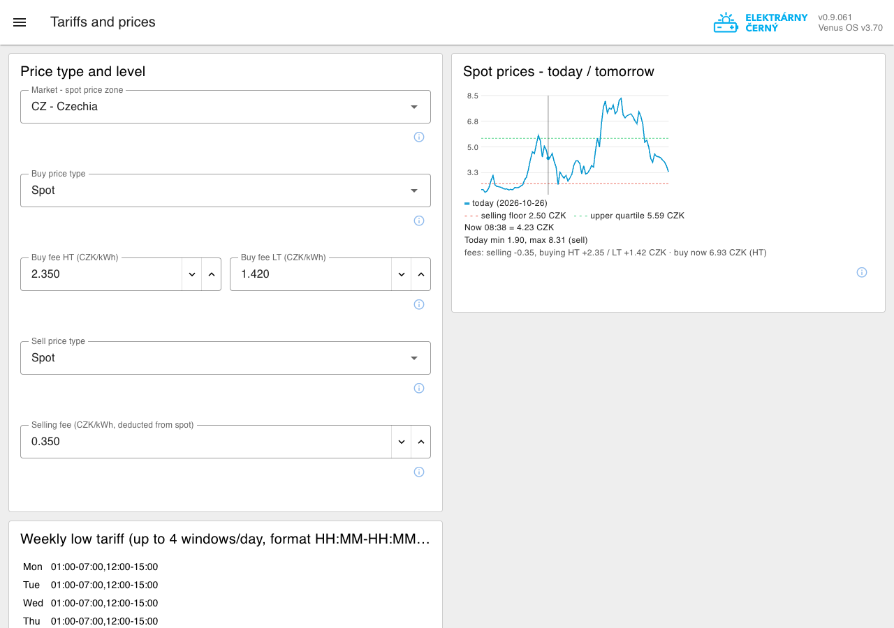
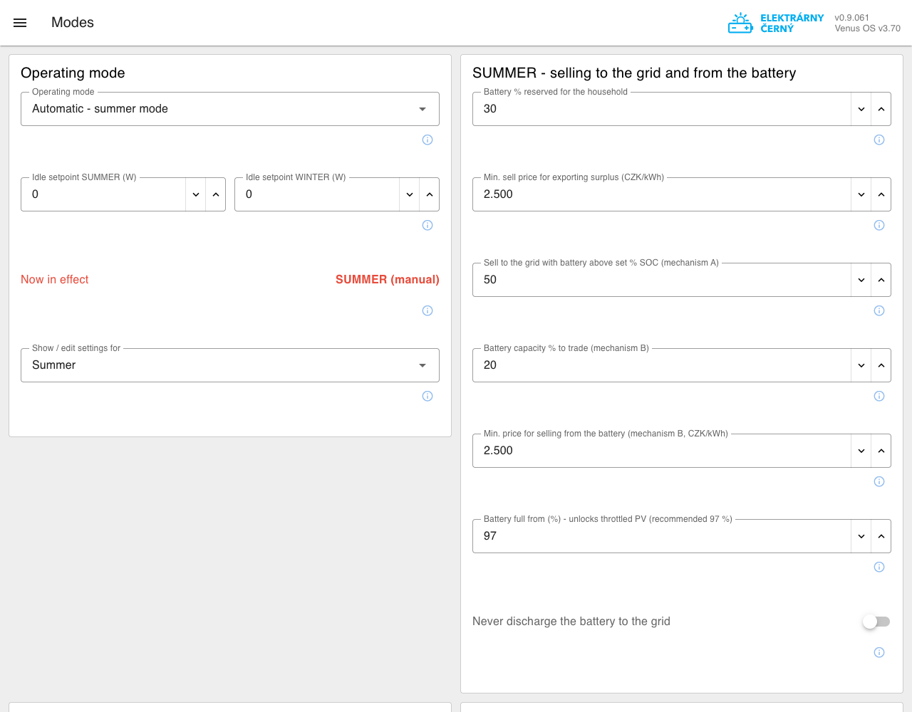

# Victron ESS Node-RED Manager

**English** · [Česky](#česky)

A Node-RED flow for **Victron GX devices (Cerbo GX, Ekrano…) with ESS** that manages a
PV + battery system against **spot electricity prices** (Czech market and other European
day-ahead zones): it sells to the grid when it pays
off, charges from the grid when it is cheap, protects against high grid voltage, switches relays
and Shelly devices, calibrates the battery SOC – all configured from a web dashboard, with an
optional read-only mobile app.

> Made by [Elektrárny Černý](https://elektrarnycerny.cz), used on real installations.
> Free for non-commercial use – see [License](#license).

## Features

- **Selling to the grid** – (A) surplus PV and battery energy when the sell price is high,
  (B) a daily plan of the most expensive quarter-hours to sell a chosen share of the battery,
  (C) morning deferral: keep morning PV for the grid when it sells better than at noon.
- **Charging from the grid** – a *minimum SOC* guaranteed by a set time, a *target SOC* only
  when the price is below a cap (reduced by the PV forecast), and charging at negative prices.
- **Summer / winter profiles** – each season has its own settings; switching by date or manually.
- **Spot prices** every 15 minutes – Czech market (spotovaelektrina.cz, fallback OTE + ČNB rate,
  CZK) or another European zone (Germany, Austria, Poland, Slovakia, Hungary, Netherlands, Belgium,
  France, Italy, Nordic and Baltic countries… – EUR, from [Energy-Charts](https://energy-charts.info)),
  local time follows the zone; distribution tariff (high/low) schedule, buy/sell fees.
- **Battery SOC calibration** – a calibration day when the battery reaches 100 % from the sun
  with a small top-up from the grid in the afternoon, instead of charging a half-empty battery
  at night.
- **Grid voltage protection** – step-wise reduction of feed-in when the phase voltage is high.
- **Relays and Shelly** (GX relays, local Shelly by IP, Shelly Cloud) switched by SOC / PV surplus.
- **Dashboard 2.0** – overview (battery, energy flow, today's energy, plan), settings with help
  for every field, statistics, config backup / restore.
- **Mobile app (PWA)** – read-only live view paired by a QR code.

## Screenshots

Demo installation (made-up data), English edition.

**Dashboard – Overview**

| Mobile app | Dashboard on a phone |
|---|---|
|  |  |

**Tariffs and prices** (market zone, fees, spot price chart) and **Modes** (summer/winter profiles)

 

## Requirements

- Victron GX with **Venus OS Large** (Node-RED included) and **ESS** configured
- **MQTT** enabled on the GX (Settings → Services → MQTT)
- Dashboard 2.0: `@flowfuse/node-red-dashboard` (tested with 1.33) – install from the palette
- Internet access for spot prices and the weather forecast (Open-Meteo)

## Installation (short)

Two editions with identical logic: [`flow-en.json`](flow-en.json) – **English dashboard**,
[`flow.json`](flow.json) – Czech dashboard.

1. In Node-RED: *Menu → Import* → select `flow-en.json` (or `flow.json`) → *Deploy*.
2. Open the dashboard (`https://<gx-address>:1881/dashboard`) → **Configuration** and fill in
   the VRM Portal ID, battery capacity, PV size, coordinates and grid feed-in limit.
3. On **Tariffs and prices** choose your **market (zone)** first (prices, currency and local time
   follow it), then set tariffs/fees, keep **Modes** on *Manual* until you have checked
   everything, then switch to automatic.

When updating to a new version, delete the flow's tabs in Node-RED first (Cmd/Ctrl-click all
tabs → Delete), then import the new `flow.json`. Settings are kept on the GX.

**English user guide: [en/README.txt](en/README.txt)**, changes: [en/CHANGELOG.txt](en/CHANGELOG.txt).
Detailed technical documentation in Czech: [cs/INSTALACE.txt](cs/INSTALACE.txt) (installation
checklist), [cs/DOKUMENTACE.txt](cs/DOKUMENTACE.txt) (how it works), [cs/CHANGELOG.txt](cs/CHANGELOG.txt).

## Data sent to the author's server

The flow reports to `vrm.elektrarnycerny.cz`: a **heartbeat** 4× a day (VRM Portal ID,
installation name, flow version, mode, sell settings, SOC, regulation state) and **live data for
the mobile app** every 2 minutes (PV, consumption, grid, battery, SOC, prices, plan; only the last
24 h are kept). No passwords, addresses or Shelly keys are sent. Installations from this public
version are kept separate from the author's own ones. To opt out, disable the nodes
*"POST heartbeat"* and *"POST zive udaje"* (tab *Statistika*) – the mobile app then stops
working, the regulation is not affected.

## License

[PolyForm Noncommercial 1.0.0](LICENSE.md) – free for personal and other non-commercial use,
including modifications. **Commercial use** (e.g. installing it for paying customers) is possible
**by agreement**: pavel@elektrarnycerny.cz.

## Support the development

If the flow is useful to you, a contribution of any amount is welcome: account
**3534348005/5500** (Czech bank account), IBAN **CZ26 5500 0000 0035 3434 8005**,
**[PayPal](https://www.paypal.com/qrcodes/managed/ebc7c6c8-0067-429e-bb78-8c7c0cae69cd)**, or scan one of the QR codes below (left: Czech banking apps, right:
PayPal).
Ideas and bug reports: pavel@elektrarnycerny.cz.

 &nbsp; 

---

## Česky

Node-RED flow pro **Victron GX (Cerbo GX, Ekrano…) s ESS**, které řídí FVE s baterií podle
**spotových cen elektřiny**: prodává do sítě, když se to vyplatí, nabíjí ze sítě, když je levno,
chrání před vysokým napětím v síti, spíná relé a Shelly a kalibruje SOC baterie. Vše se nastavuje
v dashboardu, k dispozici je i mobilní aplikace jen pro čtení.

> Vyvíjí [Elektrárny Černý](https://elektrarnycerny.cz), běží na skutečných instalacích.
> Zdarma pro nekomerční použití – viz [Licence](#licence).

### Co umí

- **Prodej do sítě** – (A) přebytek a energie z baterie při vysoké ceně, (B) denní plán
  nejdražších čtvrthodin pro prodej nastavené části baterie, (C) ranní odklad nabíjení.
- **Nabíjení ze sítě** – *nutné SOC* do nastaveného času, *cílové SOC* jen pod cenovým stropem
  (snížené podle předpovědi FVE), nabíjení při záporné ceně.
- **Letní a zimní profil** – každé období má vlastní nastavení; přepínání podle data nebo ručně.
- **Spotové ceny** po 15 minutách – český trh (spotovaelektrina.cz, záloha OTE + kurz ČNB) nebo
  jiná evropská zóna v EUR z Energy-Charts; rozvrh distribučního tarifu VT/NT, poplatky.
- **Kalibrace SOC baterie** – kalibrační den, kdy se baterie nabije ze slunce a odpoledne se ze
  sítě jen dorovná, místo nabíjení poloprázdné baterie v noci.
- **Napěťová ochrana** – postupné omezování přetoku při vysokém napětí fází.
- **Relé a Shelly** (relé GX, lokální Shelly podle IP, Shelly Cloud) podle SOC a přebytku.
- **Dashboard 2.0** – přehled, nastavení s nápovědou u každého pole, statistika, záloha
  a obnova konfigurace.
- **Mobilní aplikace** – živý přehled jen pro čtení, párování QR kódem.

### Ukázky obrazovek

Viz [Screenshots](#screenshots) výše (anglická varianta, ukázková instalace). Česká varianta
vypadá stejně, jen s českými texty.

### Požadavky

- Victron GX s **Venus OS Large** (obsahuje Node-RED) a nastaveným **ESS**
- zapnuté **MQTT** na GX (Settings → Services → MQTT)
- Dashboard 2.0: `@flowfuse/node-red-dashboard` (ověřeno s 1.33) – instalace přes paletu
- internet pro spotové ceny a předpověď počasí (Open-Meteo)

### Instalace

Česká verze dashboardu je `flow.json`, anglická `flow-en.json` (logika je stejná).
Postup krok za krokem je v [cs/INSTALACE.txt](cs/INSTALACE.txt), podrobný popis fungování
v [cs/DOKUMENTACE.txt](cs/DOKUMENTACE.txt) a historie změn v [cs/CHANGELOG.txt](cs/CHANGELOG.txt).
Při aktualizaci nejdřív v Node-RED smažte záložky flow (Cmd/Ctrl + klik na všechny → Delete)
a pak naimportujte nový `flow.json`; nastavení zůstává uložené v GX.

### Data posílaná na server autora

Flow se hlásí na `vrm.elektrarnycerny.cz`: 4× denně **heartbeat** (VRM Portal ID, název
instalace, verze, režim, nastavení prodeje, SOC, stav regulace) a každé 2 minuty **živé údaje pro
mobilní aplikaci** (server drží jen posledních 24 h). Hesla, adresy ani klíče Shelly se
neposílají. Instalace z této veřejné verze jsou vedené odděleně od instalací autora. Kdo hlášení
nechce, vypne v Node-RED uzly „POST heartbeat“ a „POST zive udaje“ (záložka Statistika) –
mobilní aplikace pak nefunguje, regulace běží dál.

### Licence

[PolyForm Noncommercial 1.0.0](LICENSE.md) – zdarma pro osobní a jiné nekomerční použití včetně
úprav. **Komerční použití** (např. nasazování zákazníkům za úplatu) je možné **po dohodě**:
pavel@elektrarnycerny.cz.

### Podpořte vývoj

Pokud vám flow slouží, budu rád za příspěvek libovolné částky na účet **3534348005/5500**, přes
**[PayPal](https://www.paypal.com/qrcodes/managed/ebc7c6c8-0067-429e-bb78-8c7c0cae69cd)** nebo přes QR kódy výše (vlevo bankovní, vpravo PayPal). Nápady a chyby: pavel@elektrarnycerny.cz.
